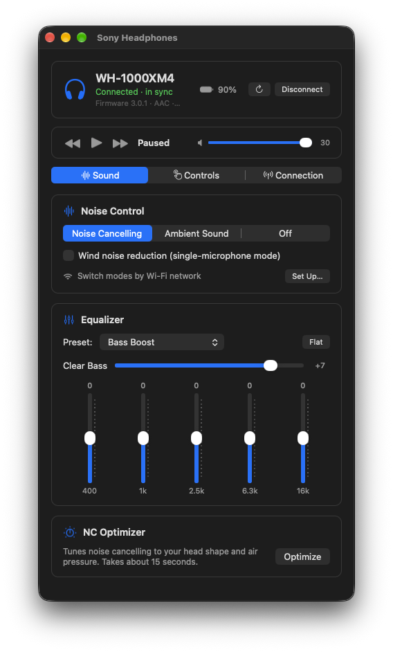
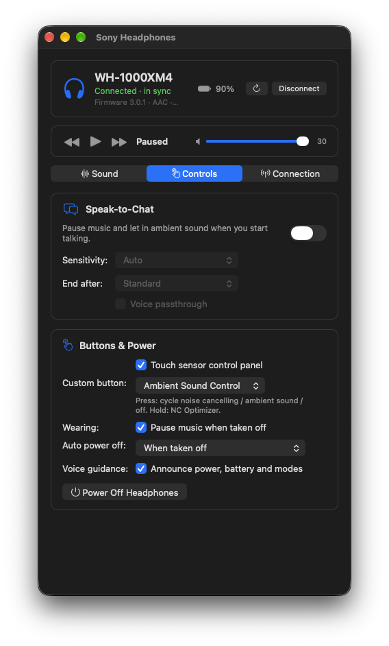
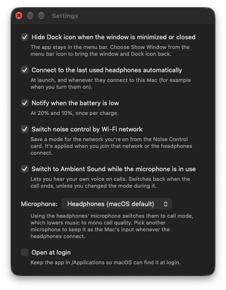

# Sony Headphones Client for macOS

A native macOS app for Sony headphones. Sony's Sound Connect app runs only on
phones; this app puts the same controls on your Mac. It is built and tested
against the **WH-1000XM4** (firmware 3.0.1). Other models that use Sony's MDR
protocol v1 may work, because the app shows only the features the headphones
report.

<p align="center">


</p>

## Features

**Sound**
- Noise cancelling, Ambient Sound (all 20 levels) and Off, with Focus on voice and wind noise reduction
- Equalizer: the headphones' presets, the 5 bands and Clear Bass
- NC Optimizer
- Surround (VPT) and sound position, on models that have them

**Controls**
- Speak-to-Chat, with sensitivity, end time and voice passthrough
- Custom button (Ambient Sound Control, Google Assistant or Alexa) and the touch sensor panel
- Pause when taken off, auto power off and voice guidance
- Power off the headphones

**Connection**
- Bluetooth priority (sound quality or stable connection) and DSEE Extreme
- Multipoint on/off, and the paired-devices list, where you can connect or disconnect each device

**Always visible**
- Battery level, firmware and codec
- Play/pause, next/previous track and headphone volume
- Changes made on the headphones or on another device show up live

**Mac extras**
- A menu bar icon with battery, noise mode and playback controls; the Dock icon can be hidden
- Automatic connection when the headphones turn on, with quiet retries
- Low-battery notifications at 20% and 10%
- Keyboard shortcuts (below)
- **Noise control by Wi-Fi network:** save a mode for each network, such as Noise Cancelling at
  home and Ambient Sound at the office. A Mac version of the places part of Sony's Adaptive Sound Control.
- **Ambient Sound during calls:** when an app uses the microphone, the headphones switch to Ambient
  Sound so you hear your own voice, then switch back afterwards. The WH-1000XM4 has no sidetone setting.
- **Preferred microphone:** keep another microphone as the Mac's input. When an app uses the
  headphones' microphone, they switch to the Bluetooth call profile and music drops to mono call
  quality. A separate mic keeps music at full quality.
- Open at login

<p align="center">

</p>

### Keyboard shortcuts

| Action | Shortcut |
|---|---|
| Noise Cancelling / Ambient Sound / Off | ⌥⌘1 / ⌥⌘2 / ⌥⌘3 |
| Play / pause | ⌥⌘P |
| Previous / next track | ⌥⌘← / ⌥⌘→ |
| Volume down / up | ⌥⌘↓ / ⌥⌘↑ |
| Reload settings from the headphones | ⌘R |
| Connect / disconnect | ⌘K |
| Sound / Controls / Connection tab | ⌘1 / ⌘2 / ⌘3 |

They work while the app is in front.

## Download

Get the latest build from [Releases](https://github.com/cspencer49519/xm4-control-app/releases):
unzip it and move `SonyHeadphonesClient.app` to Applications. The release builds aren't
notarized, so macOS blocks the first launch. Open the app once, then go to System Settings →
Privacy & Security and click **Open Anyway**. Or run:

```bash
xattr -dr com.apple.quarantine /Applications/SonyHeadphonesClient.app
```

To publish a release, push a version tag: `git tag v2.0.0 && git push github v2.0.0`.
GitHub Actions builds the macOS, Linux and Windows apps and attaches them to the release.

## Requirements

- macOS 12 or later; Open at login needs macOS 13
- Xcode, to build
- Headphones paired with the Mac in System Settings → Bluetooth

## Build and install

```bash
git clone --recurse-submodules https://github.com/cspencer49519/xm4-control-app.git
cd xm4-control-app/Client/macos
xcodebuild -project SonyHeadphonesClient.xcodeproj -scheme SonyHeadphonesClient \
  -configuration Release -derivedDataPath build build
cp -R build/Build/Products/Release/SonyHeadphonesClient.app /Applications/
```

You can also open `Client/macos/SonyHeadphonesClient.xcodeproj` in Xcode and run it.

### Code signing

By default the app is signed ad hoc, so you can build it without a certificate.
However, macOS ties privacy permissions to the signature, and an ad-hoc signature
changes with every build, so you're asked for Bluetooth access again after each
rebuild. To avoid this, create `Client/macos/Local.xcconfig`. The file is git-ignored.

```
CODE_SIGN_IDENTITY = Apple Development
CODE_SIGN_STYLE = Manual
DEVELOPMENT_TEAM = <your team ID>
```

Your team ID is the OU field of your certificate:
`security find-certificate -c "Apple Development" -p | openssl x509 -noout -subject`

### Permissions

| Permission | Why |
|---|---|
| Bluetooth | Talk to the headphones |
| Notifications | Low-battery alerts; optional |
| Location | Read the Wi-Fi network name, which macOS treats as location data. Asked for only when you set up noise control by Wi-Fi network; your location isn't recorded |

## Known limits

- **Song titles** appear only when a phone is the playing device. macOS doesn't send track
  names to Bluetooth headphones, so while the Mac plays, the strip shows "Playing" or "Paused".
- **Microphone quality on calls** depends on the Bluetooth call codec macOS negotiates. The
  headphones offer no setting for it.
- **Sidetone** ("Capture voice during a phone call") isn't available on the WH-1000XM4.
  Newer models that have it get the toggle on the Controls tab automatically.
- **Volume range:** treated as 0–30. The headphones report 31 levels and have never reported 31.

## Linux and Windows

The cross-platform Dear ImGui client in `Client/` shares the same protocol core and
builds with CMake. It has an older, smaller feature set and isn't tested on this
branch; the macOS app is the maintained client.

```bash
cd Client && mkdir build && cd build
cmake .. && cmake --build . -j
```

On Debian or Ubuntu, install `libbluetooth-dev libglew-dev libglfw3-dev libdbus-1-dev`
first. `packaging/install.sh` installs a Linux desktop launcher.

## For developers

- [`docs/PROTOCOL.md`](docs/PROTOCOL.md) documents Sony's MDR protocol v1 as the WH-1000XM4 uses it:
  framing, every command group, and packets captured from real headphones.
- Set `SONY_HEADPHONES_DEBUG=1` to log every packet in both directions:
  `SONY_HEADPHONES_DEBUG=1 /Applications/SonyHeadphonesClient.app/Contents/MacOS/SonyHeadphonesClient`
- `tests/run.sh` runs the protocol tests against a simulated headset, under
  AddressSanitizer/UBSan and ThreadSanitizer.

## Credits

This app grew out of [**SonyHeadphonesClient**](https://github.com/Plutoberth/SonyHeadphonesClient)
by Plutoberth and contributors, now archived: Plutoberth, aybruh00, Mr-M33533K5, semvis123
(original macOS support), jimzrt (Linux support) and guilhermealbm (noise cancelling controls).
It continued through [jespinobe's fork](https://github.com/jespinobe/SonyHeadphonesClient),
which added Linux and Wayland fixes. Thanks to everyone who worked on them.

## License

MIT. See [LICENSE](LICENSE).
